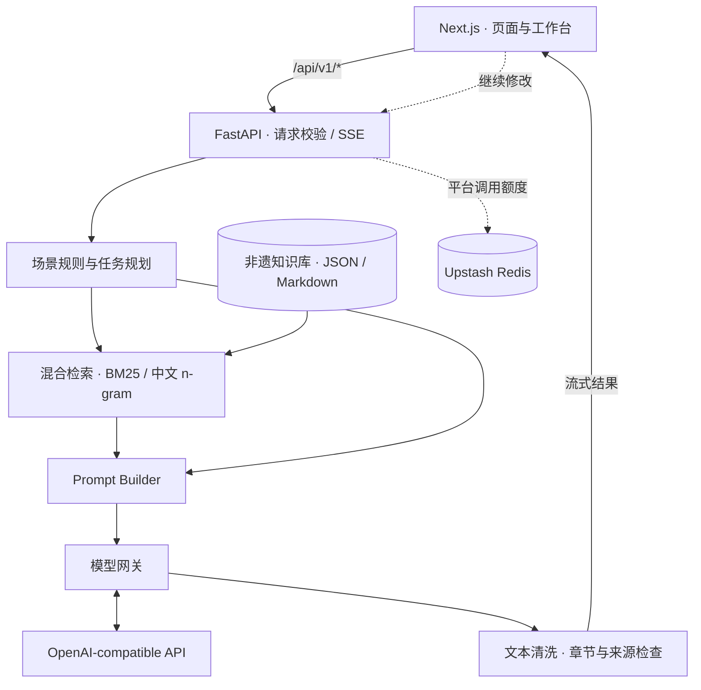

# 粤见非遗｜寻脉岭南，智游非遗

一个围绕广东非遗知识开发的文化体验工具。输入想去的城市、可用时间或感兴趣的项目，可以生成游览建议、研学任务和文化内容，也可以在已有结果上继续修改。

<p align="center">
  <a href="https://yuejian-feiyi.vercel.app/">
    
  </a>
</p>

<p align="center">
  <a href="https://yuejian-feiyi.vercel.app/">在线体验</a> ·
  <a href="#主要功能">主要功能</a> ·
  <a href="#技术实现">技术实现</a> ·
  <a href="#本地运行">本地运行</a>
</p>

## 项目介绍

广东非遗的资料分散在不同的名录、机构和地方文化介绍中。做这个项目，是想把资料查询和实际使用放在一起：了解一个项目之后，可以继续安排文化路线、制作研学记录，或者整理成适合分享的图文和视频脚本。

目前有五个入口：

| 场景 | 可以做什么 |
| --- | --- |
| 游客路线 | 按城市和时间整理文化看点、建议行程与出发提醒 |
| 学生研学 | 设计观察任务、记录表、采访问题及报告提纲 |
| 亲子体验 | 安排适龄互动、休息时间和陪护注意事项 |
| 内容创作 | 生成图文内容或带镜头、旁白的短视频脚本 |
| 非遗问答 | 查询项目背景、技艺特点和相关文化资料 |

支持快捷调整和自定义修改，结果可以保存为 Markdown、TXT 或可编辑的 Word 文档。

## 技术实现

前端使用 **Next.js 16、React 19 和 TypeScript**，后端为 **FastAPI**。网站通过 SSE 返回生成中的文本，前端负责展示、修改和导出。生产环境使用 Vercel Services，让前后端共用一个域名。



### 场景处理

`services/scenarios.py` 为五个入口设置不同的任务规则。「内容创作」内部再分图文与短视频两种模式。比如，普通路线侧重时间与节点安排；亲子体验另外考虑陪护、互动和休息；研学方案更重视能记录下来的观察结果。

`core/revisions.py` 负责修改意图与条件更新，`services/planner.py` 和 `services/prompt_builder.py` 按当前场景组织任务。不需要为每一步单独请求一次模型。

### 非遗知识库

`data/heritage_records.json` 中整理了 12 条带来源链接的非遗项目记录。其他城市文化、研学和创作资料放在 `data/` 的 Markdown 文件里。

检索采用 BM25、字符 n-gram 和元数据加权，并限制返回内容的长度。结果保留可查阅的来源；若涉及演出时间、开放状态和票价等动态信息，仍需要以实际公告为准。当前没有接入实时地图或预约接口。

### 模型与额度

既可以使用网站提供的模型，也可以在设置中填写个人 API。平台共享额度由 Upstash Redis 控制；个人密钥不写入浏览器持久化存储或导出的文件。额度限制针对请求次数，实际模型费用仍以服务商计费为准。

## 仓库结构

```text
web/                  Next.js 页面、组件与浏览器测试
api/                  FastAPI 接口
core/                 请求模型、修订规则与额度控制
services/             场景策略、知识检索、模型调用与导出
data/                 非遗项目记录与场景资料
backend/              Vercel 后端服务使用的代码镜像
evaluation/           检索评测样例
scripts/              评测脚本
tests/                Python 测试
docs/                 架构、知识库及其他维护文档
vercel.json           Vercel Services 配置
```

`backend/` 是部署时实际使用的后端代码镜像，修改 `api/`、`core/`、`services/` 或 `data/` 时需要同步对应文件。

## 本地运行

需要 Node.js 22+ 和 Python 3.11+。

克隆仓库：

```bash
git clone https://github.com/liqinglq666/Yuejian-Feiyi-Agent.git
cd Yuejian-Feiyi-Agent
```

在仓库根目录启动后端：

```bash
python -m venv .venv
# macOS / Linux
source .venv/bin/activate
# Windows PowerShell: .\.venv\Scripts\Activate.ps1

pip install -r requirements-api.txt
uvicorn api.main:app --host 127.0.0.1 --port 8000 --reload
```

另开终端启动网页：

```bash
cd web
npm install
npm run dev
```

打开 http://localhost:3000 。如果使用平台模型，需要在后端配置自己的服务端环境变量；也可以直接通过网页设置个人 API。不要把密钥提交到仓库。

## 测试

```bash
pip install -r requirements-dev.txt
ruff check .
pytest
python -m scripts.run_benchmark

cd web
npm install
npm run typecheck
npm run lint
npm run build
npm run test:e2e
```

`evaluation/benchmark.json` 目前有 60 条检索评测样例，主要检查任务路由、检索命中和来源覆盖；这些检查不能代替对生成内容的逐项事实核对。

## 相关文档

[架构与接口](docs/ARCHITECTURE.md) · [知识库维护](docs/KNOWLEDGE_BASE.md) · [测试说明](docs/EVALUATION.md) · [部署](docs/VERCEL_DEPLOYMENT.md) · [安全](SECURITY.md)

项目采用 [Apache License 2.0](LICENSE)。

> 得闲来玩，粤见非遗。
