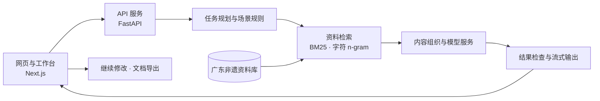

# 粤见非遗

<p align="center">
  <a href="https://yuejian-feiyi.vercel.app/">
    
  </a>
</p>

**寻脉岭南，智游非遗。**

[访问网站](https://yuejian-feiyi.vercel.app/)

粤见非遗是一处关于广东非物质文化遗产的线上资料与体验空间。从认识一项传统技艺，到规划文化路线、设计研学活动或整理创作素材，都可以在同一工作台中完成。

## 使用场景

| 场景 | 内容 |
| --- | --- |
| 游客路线 | 根据城市、兴趣和可用时间安排文化看点与游览顺序 |
| 学生研学 | 整理学习目标、观察任务、采访问题和记录表 |
| 亲子体验 | 结合儿童参与方式安排互动、休息与陪护提醒 |
| 内容创作 | 整理图文内容、视频分镜与解说稿 |
| 非遗问答 | 查阅项目背景、传统技艺和相关文化资料 |

方案支持继续调整，可导出为 Markdown、TXT 或 Word 文档。

## 系统架构

前端采用 Next.js、React 和 TypeScript，后端使用 FastAPI。文化资料保存在本地知识库中；检索结果与场景规则共同参与内容生成，结果通过 SSE 流式返回。



五种使用场景分别对应不同的内容组织规则；图文与短视频使用独立的输出要求。任务条件的更新、检索以及生成流程由后端统一处理。

知识库包含结构化非遗项目记录和城市文化、研学、创作资料。结构化记录保留来源链接与核对日期。场馆开放时间、演出安排、票价及预约状态并非实时数据，实际出行前仍需以有关机构公告为准。

## 代码结构

```text
web/           页面、交互组件与浏览器测试
api/           FastAPI 接口
core/          数据模型、修订与额度控制
services/      场景规则、资料检索、生成与导出
data/          非遗项目记录及补充资料
backend/       Vercel 部署使用的后端镜像
evaluation/    检索评测数据
scripts/       评测脚本
tests/         后端测试
docs/          架构、资料维护与测试文档
```

`backend/` 是生产环境使用的部署目录，与根目录中的后端模块保持同步；它不是可直接删除的历史副本。

## 本地运行

环境要求：Python 3.11+、Node.js 20.9+。

```bash
git clone https://github.com/liqinglq666/Yuejian-Feiyi-Agent.git
cd Yuejian-Feiyi-Agent
python -m venv .venv
pip install -r requirements-api.txt
uvicorn api.main:app --reload --port 8000
```

另开终端：

```bash
cd web
npm install
npm run dev
```

在浏览器打开 `http://localhost:3000`。需要生成内容时，可在网页设置中使用个人模型接口；平台模型由服务端配置。

## 测试

```bash
pip install -r requirements-dev.txt
ruff check .
pytest
python -m scripts.run_benchmark

cd web
npm run typecheck
npm run lint
npm run build
npm run test:e2e
```

检索评测使用 `evaluation/benchmark.json` 中的固定样例。自动化测试用于检查程序行为，不能代替文化资料的人工核对。

## 文档

[系统架构](docs/ARCHITECTURE.md) · [资料维护](docs/KNOWLEDGE_BASE.md) · [测试](docs/EVALUATION.md) · [部署](docs/VERCEL_DEPLOYMENT.md) · [安全](SECURITY.md)

[Apache License 2.0](LICENSE)

*得闲来玩，粤见非遗。*
