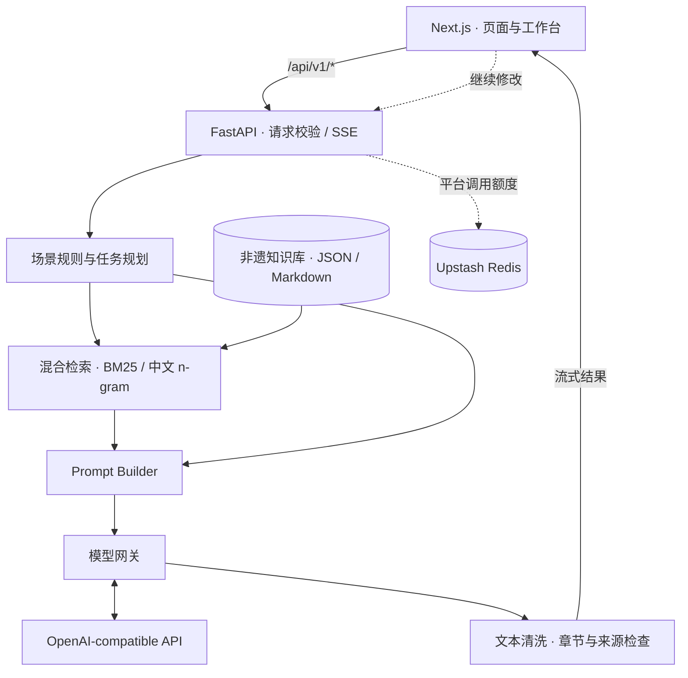

# 粤见非遗｜寻脉岭南，智游非遗

围绕广东非遗资料整理与文化体验制作的网站。输入城市、时间或感兴趣的项目，可以查阅相关文化知识，整理路线、研学任务和创作内容，也能继续修改已有结果。

<p align="center">
  <a href="https://yuejian-feiyi.vercel.app/">
    
  </a>
</p>

[在线体验](https://yuejian-feiyi.vercel.app/)

## 项目介绍

广东非遗资料散见于项目名录、文化机构和地方介绍。这个网站把查资料与后续整理放在一起：了解某项技艺之后，可以继续安排文化路线、准备研学记录，或写成图文与视频脚本。

目前有五个入口：

| 场景 | 可以做什么 |
| --- | --- |
| 游客路线 | 按城市和时间整理文化看点、建议行程与出发提醒 |
| 学生研学 | 设计观察任务、记录表、采访问题及报告提纲 |
| 亲子体验 | 安排适龄互动、休息时间和陪护注意事项 |
| 内容创作 | 生成图文内容或带镜头、旁白的短视频脚本 |
| 非遗问答 | 查询项目背景、技艺特点和相关文化资料 |

支持快捷调整和自定义修改，结果可以保存为 Markdown、TXT 或可编辑的 Word 文档。

## 技术实现

网站使用 Next.js、React 和 TypeScript 构建页面，FastAPI 处理请求、资料检索和模型调用。生成内容通过 SSE 逐步返回。前后端部署在同一个 Vercel 项目中。



### 场景处理

五个入口分别使用对应的任务规则，图文和短视频有各自的处理方式。游客路线主要处理时间与节点；亲子体验会补充陪护和休息安排；研学方案则强调观察记录。相关规则写在 `services/scenarios.py`。

修改时先更新当前任务条件，再据此重新整理生成内容。对应代码位于 `core/revisions.py`、`services/planner.py` 和 `services/prompt_builder.py`。

### 非遗知识库

`data/heritage_records.json` 中整理了 12 条带来源链接的非遗项目记录。其他城市文化、研学和创作资料放在 `data/` 的 Markdown 文件里。

检索采用 BM25、字符 n-gram 和元数据加权，并限制返回内容的长度。结果保留可查阅的来源；若涉及演出时间、开放状态和票价等动态信息，仍需要以实际公告为准。当前没有接入实时地图或预约接口。

### 模型与额度

可以使用网站提供的模型，也可以在设置中填写个人 API。共享模型通过 Upstash Redis 限制调用次数；个人密钥不会保存到浏览器的持久化存储或导出文件。

## 仓库结构

```text
web/                  Next.js 页面、组件与浏览器测试
api/                  FastAPI 接口
core/                 请求模型、修订规则与额度控制
services/             场景策略、知识检索、模型调用与导出
data/                 非遗项目记录与场景资料
backend/              Vercel 后端服务使用的代码镜像
evaluation/           检索评测样例
scripts/              评测脚本
tests/                Python 测试
docs/                 架构、知识库及其他维护文档
vercel.json           Vercel Services 配置
```

`backend/` 是部署时实际使用的后端代码镜像，修改 `api/`、`core/`、`services/` 或 `data/` 时需要同步对应文件。

## 本地运行

需要 Node.js 22+ 和 Python 3.11+。

克隆仓库：

```bash
git clone https://github.com/liqinglq666/Yuejian-Feiyi-Agent.git
cd Yuejian-Feiyi-Agent
```

在仓库根目录启动后端：

```bash
python -m venv .venv
# macOS / Linux
source .venv/bin/activate
# Windows PowerShell: .\.venv\Scripts\Activate.ps1

pip install -r requirements-api.txt
uvicorn api.main:app --host 127.0.0.1 --port 8000 --reload
```

另开终端启动网页：

```bash
cd web
npm install
npm run dev
```

打开 http://localhost:3000 。如果使用平台模型，需要在后端配置自己的服务端环境变量；也可以直接通过网页设置个人 API。不要把密钥提交到仓库。

## 测试

```bash
pip install -r requirements-dev.txt
ruff check .
pytest
python -m scripts.run_benchmark

cd web
npm install
npm run typecheck
npm run lint
npm run build
npm run test:e2e
```

`evaluation/benchmark.json` 包含 60 条检索样例，检查任务路由、检索命中和来源覆盖。对于具体文化事实，仍需核对原始资料。

## 相关文档

[架构与接口](docs/ARCHITECTURE.md) · [知识库维护](docs/KNOWLEDGE_BASE.md) · [测试说明](docs/EVALUATION.md) · [部署](docs/VERCEL_DEPLOYMENT.md) · [安全](SECURITY.md)

项目采用 [Apache License 2.0](LICENSE)。

> 得闲来玩，粤见非遗。
