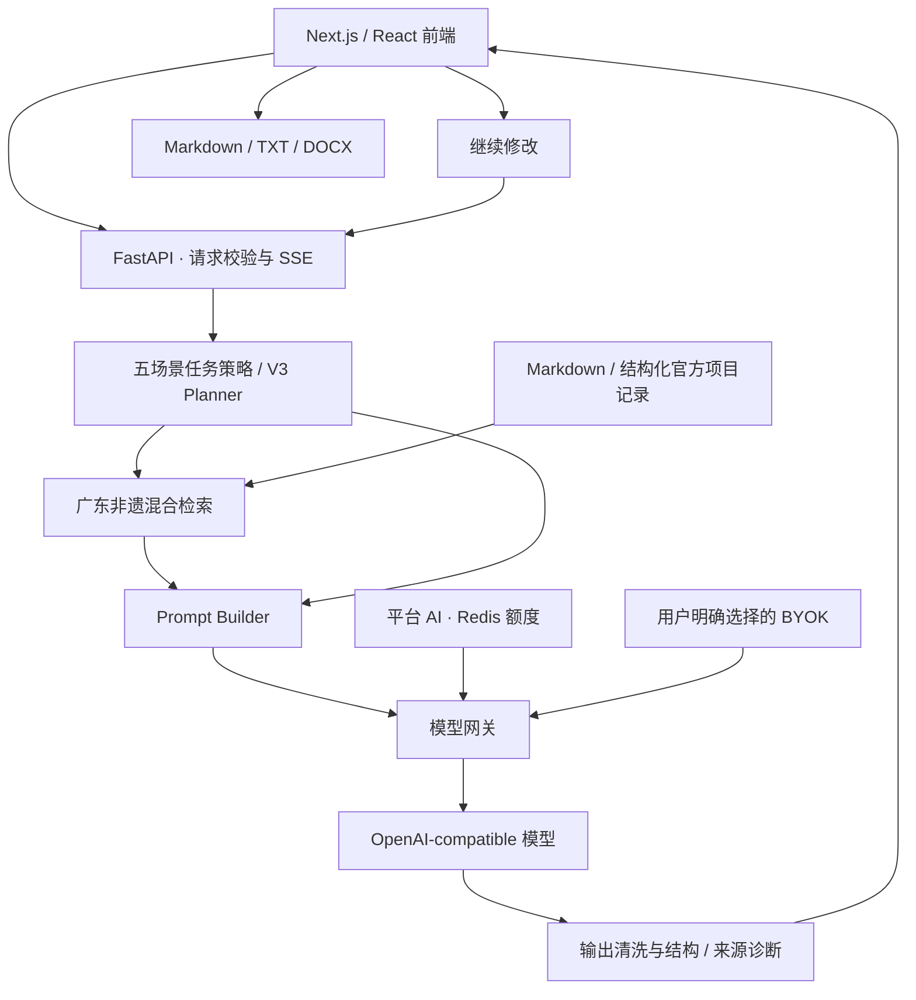

# 粤见非遗｜寻脉岭南，智游非遗

> 面向广东文旅体验、非遗研学与文化传播的 AI Agent。结合结构化需求、可追溯的非遗知识检索和场景专属任务规划，帮助用户把文化兴趣转化为路线、研学任务、亲子活动与创作内容。

<p align="center">
  <a href="https://yuejian-feiyi.vercel.app/">
    
  </a>
</p>

<p align="center"><strong>点击上方图片，打开粤见非遗在线网站</strong></p>

<p align="center">
  
  
  
  
  
</p>

<p align="center">
  <a href="https://yuejian-feiyi.vercel.app/">在线体验</a> ·
  <a href="#项目简介">项目简介</a> ·
  <a href="#核心能力">核心能力</a> ·
  <a href="#技术架构">技术架构</a> ·
  <a href="#快速开始">快速开始</a> ·
  <a href="#测试与评测">测试与评测</a>
</p>

---

## 项目简介

广东有丰富的非物质文化遗产，但规划一次文化体验常常需要分别查找项目资料、安排路线、设计学习活动、再整理分享内容。「粤见非遗」尝试将这些工作连接为一条可继续调整的任务流程：

```text
自然语言 + 结构化条件
        ↓
五场景任务路由与专属规划
        ↓
广东非遗 RAG 检索与来源检查
        ↓
模型生成 · 流式呈现
        ↓
场景规则检查与继续调整
        ↓
Markdown / TXT / Word 导出
```

当前支持五类任务：

| 场景 | 主要输出 |
| --- | --- |
| 游客路线 | 文化看点、建议行程、体验记录与出发前提醒 |
| 学生研学 | 学习目标、现场任务卡、观察记录表与报告提纲 |
| 亲子体验 | 轻量行程、亲子互动、陪护与安全提示 |
| 内容创作 | 图文标题、正文、配图建议，或短视频分镜与旁白 |
| 非遗问答 | 项目背景、技艺特点、体验方式与待核验信息 |

## 核心能力

### 1. 五场景独立任务规划

用户先选择任务场景，再补充城市、时长、身份和兴趣等条件。`TaskRequest` 明确记录任务类型；`services/scenarios.py` 为游客路线、研学、亲子、图文、视频和问答设置不同的约束及诊断规则。

亲子体验不再简单沿用游客路线模板：会考虑儿童互动、监护和休息。研学任务强调可观察目标及记录方式；创作任务区分文化事实与创意表达。图文和视频属于「内容创作」的两个子模式。

### 2. 有来源的广东非遗 RAG

知识检索由 `services/retrieval.py` 实现，组合 BM25、中文字符 n-gram、城市/主题元数据权重、去重及上下文字符预算，不依赖额外向量数据库。

知识库包括两部分：

- `data/heritage_records.json`：现有 **12 条**带国家级非遗项目页面链接的结构化记录，包含名称、城市、类别、来源、核验日期及体验建议。
- `data/*.md`：城市路线、研学和创作等补充资料，支持 Markdown Front Matter 元数据。

检索排序考虑相关性与来源可信度；只有与当前主题直接匹配的官方项目记录才计入来源诊断。**检索到了官方资料，并不代表模型输出的每句话都已经获得事实验证。**

### 3. 知识约束与结果检查

模型生成前先整合任务要求与检索材料，区分可查证的文化事实和网站自行提出的体验建议。

生成完成后，系统检查必要章节、来源主题匹配和各场景的部分结构要求。此类检查属于规则诊断，而不是对事实、安全或可预约性的自动认证。演出、票价、场馆开放和交通时间等信息仍需按实际情况确认。

### 4. 连续调整与场景切换

支持快捷修改和自定义要求，例如「压缩成半天」「改成亲子版」「生成短视频脚本」。每次修改基于**当前生效条件、已有答案和本轮要求**重新规划，不将历史长 Prompt 逐轮复制；发生任务转换时使用新场景的专属策略。

### 5. 流式生成与结果阅读

FastAPI 通过 SSE 提供 `stage / snapshot / delta / complete / failure` 事件。Next.js 工作台逐步呈现生成内容，并支持停止生成、重新尝试、查看知识来源及按章节阅读。完成事件包含首字延迟和生成阶段耗时，供界面展示和排查。

### 6. 平台模型与个人 BYOK

网站可使用部署者提供的共享模型，或由用户在「AI 设置」中主动填写自己的 OpenAI-compatible API。

- 平台共享额度使用 **Upstash Redis** 原子计数保护；Redis 未正确配置时不开放平台付费生成。
- 平台模式不会悄悄切换到用户的个人 Key；个人 Key 不写入持久化浏览器存储、最近方案或导出文件。
- 模型网关检查 HTTPS 与地址安全，生产环境的个人 BYOK 域名也受到可信主机列表约束。
- 限额按请求次数计算，不等于精确 Token 或货币预算。取消生成也不保证退回已经计费的部分。

### 7. 多格式导出

生成结果可导出 **Markdown（.md）、纯文本（.txt）和可编辑 Word（.docx）**，适合进一步整理旅游计划、研学记录与文化传播内容。

---

## 技术架构



| 层级 | 技术或模块 | 作用 |
| --- | --- | --- |
| 前端 | Next.js 16、React 19、TypeScript | 响应式网页、任务输入、流式阅读与交互 |
| API | FastAPI、Pydantic | 参数校验、任务路由、流式输出与导出 |
| Agent | `core/models.py`、`core/revisions.py`、`services/scenarios.py` | 结构化需求、场景策略、连续调整 |
| RAG | Python、BM25、字符 n-gram、元数据加权 | 非遗知识检索和来源追溯 |
| 模型 | OpenAI Python SDK、兼容 Chat Completions 的服务 | 平台模型与个人 BYOK |
| 配额 | Upstash Redis | 平台共享调用的原子计数 |
| 文档 | python-docx | 可编辑 Word 及文本导出 |
| 部署 | Vercel Services | 同一域名下运行前端和后端 |
| 测试 | Pytest、Ruff、Playwright、GitHub Actions | Python、网页与检索回归 |

## 项目结构

```text
Yuejian-Feiyi-Agent/
├── web/                         # Next.js 前端、响应式样式与浏览器测试
│   ├── app/                     # 首页与工作台入口
│   ├── components/studio-app.tsx # 五场景工作台
│   ├── lib/                     # API / SSE 客户端与类型
│   └── public/heritage/         # 当前网站插画
├── api/main.py                  # FastAPI 接口
├── core/                        # 请求模型、模型配置、额度与修订规则
├── services/                    # 任务策略、规划、RAG、模型与导出
├── data/                        # 官方非遗记录和补充知识资料
├── backend/                     # Vercel Backend Service 部署镜像
├── evaluation/benchmark.json    # 60 条检索测试场景
├── scripts/                     # 检索评测与受控模型验收工具
├── tests/                       # Python 单元与回归测试
├── docs/                        # 设计、架构、知识库与安全说明
├── vercel.json                  # Vercel 双服务配置
└── .github/workflows/           # CI 与生产冒烟检查
```

> `backend/` 是 Vercel 多服务部署需要的独立代码镜像。修改根目录的 API、核心模型、服务或知识库时，应同步相应的后端文件。旧版 Streamlit 页面已经移除。

---

## 快速开始

### 1. 克隆仓库

```bash
git clone https://github.com/liqinglq666/Yuejian-Feiyi-Agent.git
cd Yuejian-Feiyi-Agent
```

要求：**Node.js 22+、Python 3.11+**。

### 2. 创建 Python 环境

**Windows（PowerShell）**

```powershell
python -m venv .venv
.\.venv\Scripts\Activate.ps1
python -m pip install -r requirements-api.txt
Copy-Item .env.example .env
```

**macOS / Linux**

```bash
python3 -m venv .venv
source .venv/bin/activate
python -m pip install -r requirements-api.txt
cp .env.example .env
```

`.env` 仅用于本地服务端，不应提交到 Git。可按需设置 `OPENAI_API_KEY`、`OPENAI_BASE_URL`、`MODEL_NAME`、`PLATFORM_API_ENABLED`；如需向公众开放平台额度，还应配置 Upstash Redis。不开通平台共享 AI 时，用户可以在工作台选择自己的 API。

### 3. 启动 API

```bash
uvicorn api.main:app --host 127.0.0.1 --port 8000 --reload
```

### 4. 启动网页

另开一个终端：

```bash
cd web
npm install
npm run dev
```

打开 **http://localhost:3000**。开发模式下，前端将 `/api/v1/*` 请求转发到本机 FastAPI；正式部署由 `vercel.json` 的双服务路由处理。

---

## 知识库维护

在 `data/heritage_records.json` 中，每条官方项目记录保存项目名称、别名、所属城市、类别、名录来源、链接和核验日期；体验建议与现场信息提示单独填写，不能标作官方已开放活动。

补充资料可以继续使用 Markdown / TXT，并在 Markdown 中填写 `title`、`city`、`category`、`source_name` 和 `source_url` 等字段。新增项目时应核对具体的官方项目页面，不能凭名称推断项目编号或核验状态。

详见 [知识库规范](docs/KNOWLEDGE_BASE.md) 和 [RAG 资料说明](docs/KNOWLEDGE_BASE_UPGRADE.md)。

---

## 测试与评测

在仓库根目录：

```bash
python -m pip install -r requirements-dev.txt
ruff check .
python -m compileall -q .
pytest
python -m scripts.run_benchmark
```

前端检查：

```bash
cd web
npm install
npm run typecheck
npm run lint
npm run build
npm run test:e2e
```

当前检索评测包括 **60 条覆盖五种任务场景的样例**，用于检查任务路由、主题命中和官方来源覆盖。它不等于生成内容的事实准确率。浏览器回归使用模拟模型响应；真实模型的质量、费用和延迟需要独立验收。

---

## 已知限制

- 知识库为可扩展的轻量本地 RAG，尚未接入大型向量数据库。
- 路线未接入实时地图、POI、交通时间或活动预约，输出为文化体验建议，不构成预订或出行时间承诺。
- 规则自检不代表对模型每条陈述完成事实核验；重要文化信息应复核原始来源。
- 公开模型服务仍需配合预算、访问限制及异常调用监测，单实例限流无法覆盖全部服务实例。
- Word 导出强调可编辑性，不保证复杂 Markdown 的所有排版在文档中完全一致。

## 文档与贡献

- [系统架构](docs/ARCHITECTURE.md) · [Agent V3](docs/AGENT_V3.md) · [运行可靠性](docs/AGENT_RELIABILITY.md)
- [知识库规范](docs/KNOWLEDGE_BASE.md) · [评测说明](docs/EVALUATION.md) · [部署说明](docs/VERCEL_DEPLOYMENT.md)
- [安全政策](SECURITY.md) · [参与贡献](CONTRIBUTING.md)

本项目使用 [Apache License 2.0](LICENSE)。

> 得闲来玩，粤见非遗。让非遗从资料里走出来，进入每一次旅行、课堂与创作。
